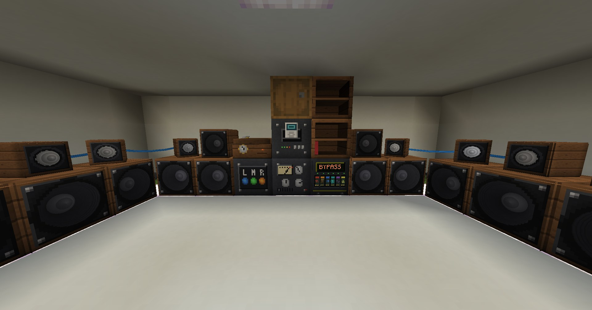
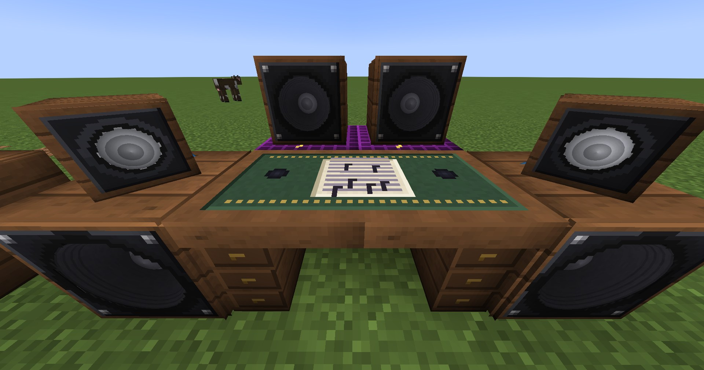
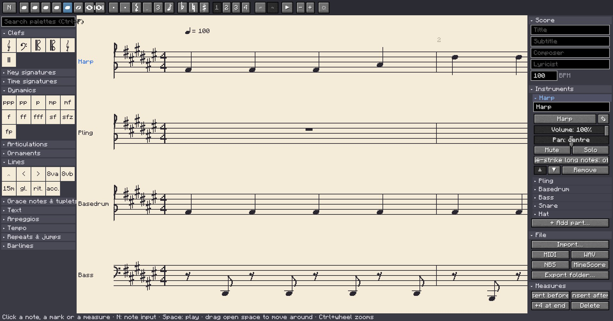
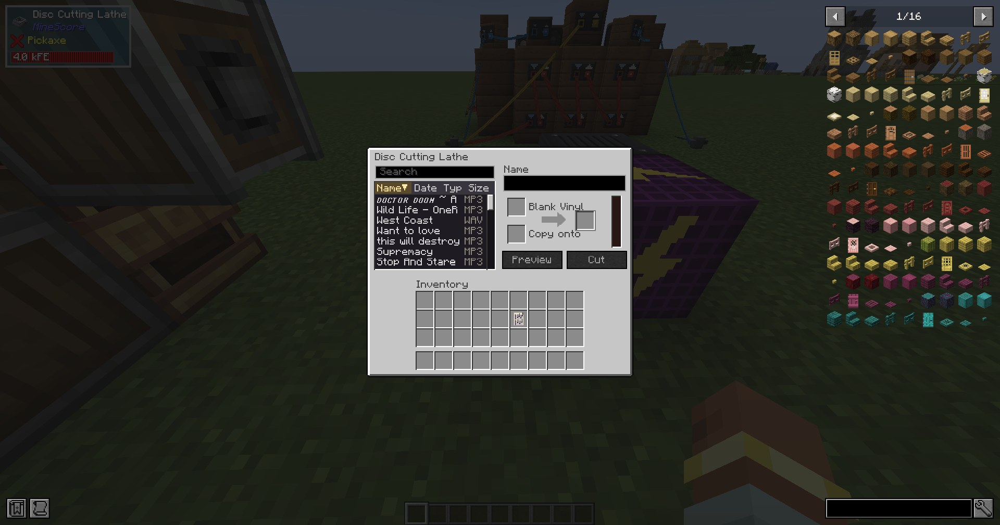
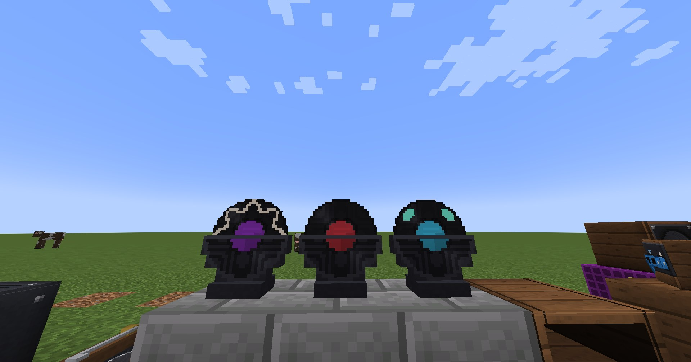
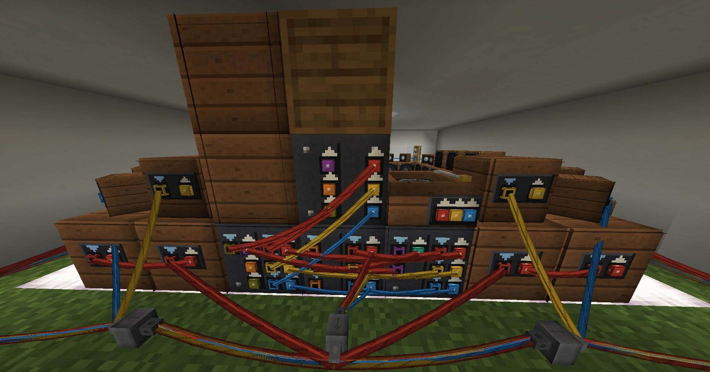
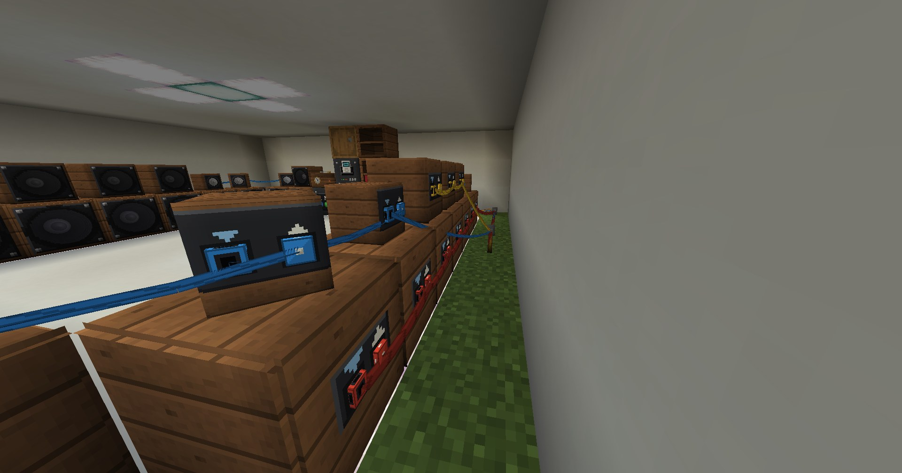
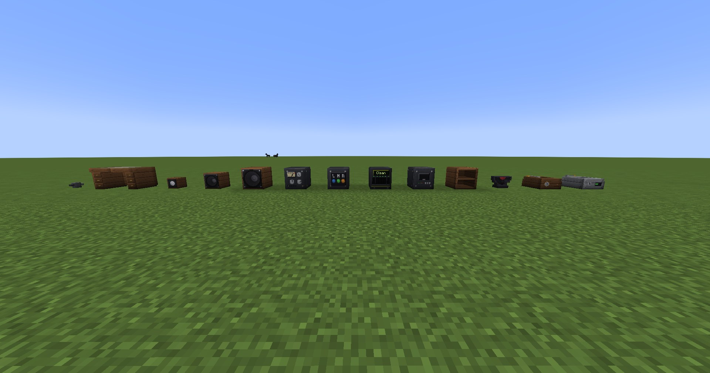
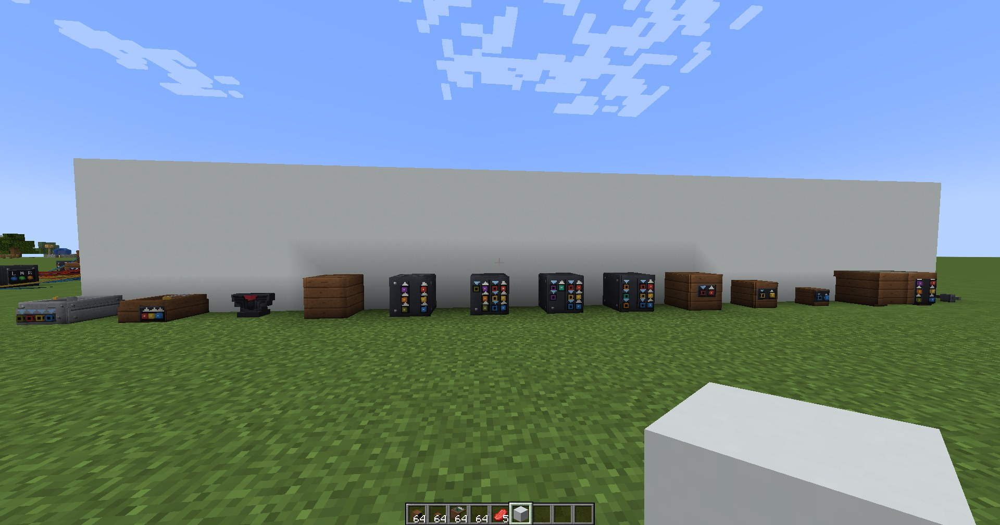
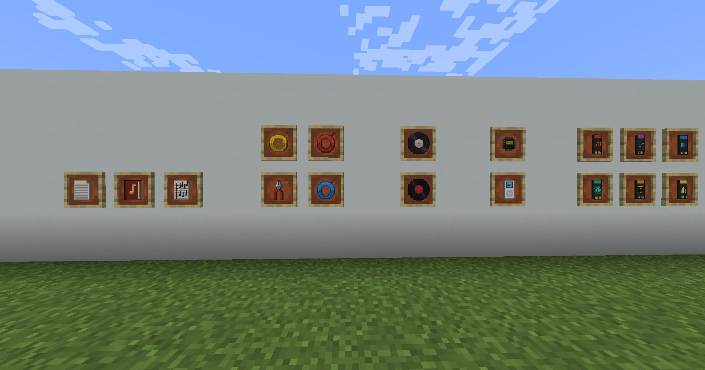

# MineScore

Real music in Minecraft. Cut your own songs onto vinyl, carry them around on an MP3 player, wire up a proper hi-fi system, and write your own music at the Composer's Desk.

**Minecraft 1.20.1 · Forge 47+** · needed on both the client and the server



## What's in it

- **Records from your own music.** Put MP3, OGG, WAV, FLAC, MIDI or Note Block Studio files in the `blkcdsongs` folder of your game folder, then cut them onto Blank Vinyl at the Disc Cutting Lathe. Copy records, dye them, trim them at a smithing table, and play them on the Vinyl Player.
- **MP3 Player.** Load songs onto it at the lathe and get a library, playlists, a queue and a 10-band EQ. Listen on your own, or right-click a speaker to play it through that speaker for everyone nearby.
- **A hi-fi system you wire yourself.** Subwoofers, Middle Speakers and Tweeters each play their own band. Run speaker wire from a source (Mixing Console, Composer's Desk or Vinyl Player) through a Channel Manager for left/right stereo and an Amp for volume, EQ and boost. Drive a speaker too hard and it blows.
- **Multi-Effects Unit.** Up to six effect cards (drive, modulation, delay, reverb, amp and cabinet modeling, dynamics and utility) with knobs, bypass switches, an expression pedal and preset chips. Wire it into the lathe and the effects get cut into the record.
- **Composer's Desk.** Put two desk blocks side by side and you get a score editor in the style of MuseScore: notes, rests, ties, slurs, dynamics, articulations, lyrics, chord symbols, repeats, tuplets and more. Several players can edit the same score at once. It imports and exports MIDI, Note Block Studio and MineScore files, and you can press a score onto a record.
- **Sound that fits the room.** Speakers sound fuller in a closed room, blocks between you and a speaker muffle it, and records on the Vinyl Player get a little crackle.
- **Power and redstone.** Systems run on Forge Energy (or switch it off in the settings), and every hub can be driven by redstone and read with a comparator.
- **Storage.** The Vinyl Display shows off a record, and the Music Cabinet holds 16 scores and 8 records.
- **Built-in packs.** Modern Studio, Retro Hi-Fi and a 16× version of the default look, plus Retro and Studio sound packs. Turn them on under Options → Resource Packs.
- **The MineScore Manual** in game, 19 advancements, and settings for everything (press Ctrl+M in game). Operators can change server settings from inside the game.
- **19 languages.** English, German, Spanish (Spain, Mexico, Argentina), French (France, Canada), Italian, Portuguese (Brazil, Portugal), Dutch, Polish, Russian, Ukrainian, Turkish, Swedish, Japanese, Korean, and Simplified and Traditional Chinese. The mod follows whatever language Minecraft is set to.

## Screenshots

<table>
<tr>
<td><br><b>Composer's Desk</b>: two desk blocks side by side</td>
<td><br><b>The score editor</b> at the Composer's Desk</td>
</tr>
<tr>
<td><br><b>Disc Cutting Lathe</b>: pick a song and cut it onto vinyl</td>
<td><br><b>Vinyl Displays</b> showing off dyed records</td>
</tr>
<tr>
<td><br><b>Speaker wire</b> running from the hubs to every speaker</td>
<td><br><b>A long chain of speakers</b> on one system</td>
</tr>
<tr>
<td><br><b>Every block</b>, from the front</td>
<td><br><b>Every block</b>, from the back</td>
</tr>
<tr>
<td colspan="2"><br><b>Every item</b></td>
</tr>
</table>

## Works with (optional)

- **Create 6.0+**: the Disc Cutting Lathe can run on rotation instead of power.
- **JEI**: recipes and info pages for every block and item.
- **Jade** and **The One Probe**: what a speaker or hub is doing, at a glance.

## Installing

1. Install Forge for Minecraft 1.20.1 (47.x).
2. Put `minescore-forge-1.0.0.jar` in your `mods` folder (and on the server too, if you're playing on one).
3. Make a `blkcdsongs` folder in your game folder and put your music in it.

## Building from source

You need **JDK 17**.

```bat
set "JAVA_HOME=C:\Program Files\Java\jdk-17"
gradlew.bat build
```

The jar ends up in `forge/build/libs/`. `gradlew.bat :forge:runClient` starts a test game.

The textures, models, language files and recipes are generated by `python tools/gen_resources.py` (run the Gradle build once first so the translation list exists). Translations live in `tools/lang/`; `python tools/i18n.py` shows what's missing in each language. The full design is in [SCOPE.md](SCOPE.md).

| Folder | What's in it |
|---|---|
| `common/` | All of the mod's code and assets |
| `forge/` | The Forge entry point |
| `tools/` | Texture, resource, recipe and translation generators |

## Reporting problems

Open an issue on the [issue tracker](https://github.com/smithmediaindustriesinc-code/MineScore/issues). Your game log (`logs/latest.log`) helps a lot.

## License

All rights reserved. See [LICENSE](LICENSE).
